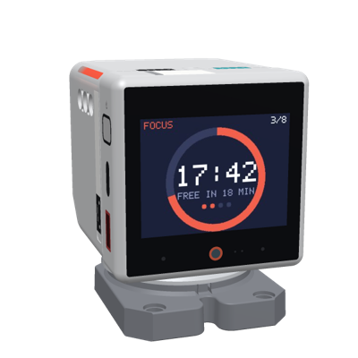

# q41eu-focus



**Focus** is a focus timer for Stackchan robots in Embody Mode, in the style of the Pomodoro
Technique®: focus for 25 minutes, a 5 minute break, and a longer break after every four. The
robot is the timer: it shows the time left as a ring, lights its LEDs as a shrinking bar, chimes
and nods when a phase ends, and tells the room "FREE IN 12 MIN" while you focus. No phone is
needed: tap the robot's screen to start or pause, hold it to skip. A phone or computer paired by
the robot's QR code runs it too, and keeps the statistics. Online at [focus.q41.eu](https://focus.q41.eu).

The Pomodoro Technique® is a registered trademark of Francesco Cirillo; this project is not
affiliated with it.
Stack-chan (スタックチャン) is a registered trademark of Shinya Ishikawa; this project is
independent and only made to work with Stack-chan robots.

> **A proof of concept, vibe coded.** Written with AI agents and tested on real hardware at home,
> but neither the code nor its security has been reviewed by humans.
>
> **Early stage: no backward compatibility.** Protocols, APIs and stored settings change when
> something better comes along, without migrations.

Part of [i41eu-arch](https://github.com/i41-eu/i41eu-arch), a local first, privacy first platform
for a home.

## How the pieces fit

| Piece | What it is | Needed? |
|---|---|---|
| **Robot** | a Stackchan with the [Embody Mode firmware](https://github.com/i41-eu/i41eu-StackChan/tree/embody/firmware/main/apps/app_embody_mode). On its screen the **app switcher** (the QR screen: Next, Connect) lists its apps and switches between them; its gear opens the **Manager screen** (which manager it has, turn it off or on). | yes |
| **Apps** | what the robot does, one at a time. Each app is a web service: the robot connects to it, and a phone or browser opens its web page. This repo is [Focus](https://s.i41.eu/focus); the apps online: [s.i41.eu](https://s.i41.eu/#apps) | at least one |
| **Phone or browser** | opens an app's page and pairs with the robot by scanning its QR code | for Focus: optional (settings, statistics) |
| **Manager** | [i41eu-manager](https://github.com/i41-eu/i41eu-manager): the web service that sets robots up over USB, gives each robot its own token per app, and switches and changes apps from its page; on your own computer (the home manager) or online at [m.i41.eu](https://m.i41.eu) | optional |

## On the robot

- **The screen:** the phase (FOCUS, SHORT BREAK, LONG BREAK), the time left as a ring and as
  digits, today's count (with the daily goal), the set's dots (a long break after every four), and
  a line for the room: "FREE IN 12 MIN" while focusing, "STRETCH" or "TAKE A WALK" on a break,
  "PAUSED", "TAP TO FOCUS".
- **Touch:** tap the screen (or touch the head) to start or pause, hold the screen to skip to the
  next phase. A focus period cut short does not count, and nothing punishes it.
- **Lights:** both LED strips show the time left, dim, red while focusing, green or blue on a
  break, amber when paused; off when idle. A sign for others in the room.
- **At the end of a phase:** a chime (a rising bell after focus, two calm notes after a break),
  a nod after focus, a look up after a break. Each can be turned off.
- The robot shows the timer from the start: no browser has to pair. The QR code stays a swipe
  away (swipe up, QR) for a phone.

## On the page

The timer with Start/Pause, Skip and Reset (Space starts or pauses), what you focus on (the
week's statistics count by it), two marks for interruptions without stopping the timer (the
technique's ' for "distracted myself" and – for "interrupted"), today's focus periods, minutes and
days in a row, the last seven days, and the settings: presets 25/5, 50/10, 90/20, each length,
the long break interval, a daily goal, when a day starts (for night owls), whether breaks and
focus start by themselves (off by default), and the robot's chime, lights and moves.

With a Stackchan manager's sign-in (`-manager-sign-in`), the owner's signed-in browsers get their
robots without the QR code.

## Run

```bash
go run ./cmd/q41eu-focus -tz Europe/Prague            # :8775; robots use the shared robot token
go run ./cmd/q41eu-focus -manager-url https://m.i41.eu -manager-secret-file /secrets/focus \
  -manager-sign-in -public-url https://focus.example -state-database postgres://focus@db/focus
```

Flags: `-listen` (`:8775`), `-public-url`, `-token-file` (the shared robot token, the same file
as q41eu-raw's by default), `-state-file` or `-state-database` (Postgres through
q41eu-raw's `statestore`), `-tz` (the time zone of the statistics' days), `-ui-dir`
(development: the page from disk), `-manager-url`, `-manager-secret-file`, `-manager-sign-in`.

Add it to a robot as any app: in a manager's catalog
(`{"id": "focus", "name": "Focus", "url": "wss://focus.example", "secret_file": "…"}`), or over USB.

## Test

```bash
gofmt -l . && go vet ./... && go test -race ./...
```

## License

Apache-2.0, see [LICENSE](LICENSE).
